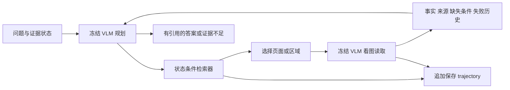

# Multimodal Evidence Agent

面向长文档、多跳 VQA 的研究原型：**冻结视觉 LLM，以证据状态驱动检索；保存完整 rollout，后续只训练 retriever / embedding model。**

已实现 PDF / 数据集页面图像接入、全局检索、页面区域重读、原生图像输入、证据记忆、引用输出、预算限制、批量 rollout、轨迹记录、标注模板、SFT / RL 数据导出和反事实分支重放。

当前默认检索是 **BM25 基线**，不是已经训练好的多模态 embedding。Dense 模式支持真实向量索引和可替换编码器。当前没有实现或运行 SFT / PPO / GRPO 优化器，也不声称已经有 benchmark 提升。离线 Demo 使用脚本模型，只验证管线；真实视觉推理需要配置 VLM。

## 1. 先跑通

```bash
cd /Users/xuyuchao/Desktop/multimodal_agent
./run.sh demo
```

不需要 API key。首次运行生成 `data/demo/`，输出两跳答案、来源引用和轨迹目录。已有示例保存在 `examples/offline_demo/`。再次运行请使用新目录：

```bash
./run.sh demo --output data/demo-second
```

`run.sh` 优先使用 `.venv`，再查找 Python 3.10+ 和已安装的依赖；在当前机器也能使用 Codex 自带 Python。需要自建环境时：

```bash
python3.12 -m venv .venv
source .venv/bin/activate
python -m pip install -e .
python -m unittest discover -s tests -v
```

也可以设置 `MMAGENT_PYTHON` 指向已有环境。系统自带 Python 3.9 不满足要求。

## 2. 接入你的 PDF 和真实视觉模型

将配置复制为工作配置，填写自己部署或可调用的视觉模型名称：

```bash
cp configs/local.example.json configs/local.json
# 编辑 configs/local.json 的 model / base_url。
# 本地服务没有认证时可以使用占位值 local。
export MMAGENT_API_KEY=local

./run.sh ingest /Users/xuyuchao/Desktop/long_document_understanding/paper \
  --output data/papers

./run.sh ask --corpus data/papers --config configs/local.json \
  --question 'ITER 如何构造历史条件检索状态？这种设计用于多模态页面检索时有什么局限？' \
  --runs runs
```

云端服务可从 `configs/openai.example.json` 开始，密钥通过环境变量设置，不写入配置或轨迹。`.env.example` 仅为示例，程序不自动读取 `.env`。真实运行会把选中的页面图像和证据状态发送到配置的模型服务。

模型接口使用 `/chat/completions`，通过 base64 PNG 原生传入图像，格式依据 [OpenAI 官方图像输入文档](https://developers.openai.com/api/docs/guides/images-vision)。本地兼容服务可以设置 `json_mode: false`、`output_token_field: "max_tokens"`；默认使用 `max_completion_tokens`。配置中的模型名称必须换成实际支持图像输入的模型。

读取支持：单个 PDF 或递归 PDF 目录。可以用 `--max-pages 3` 限制每份文档的索引页数做验证。输出目录必须不存在，避免覆盖已有索引。PDF 会复制到索引目录以保留来源版本。

每页建立三个固定 view：整页、上半页、下半页。区域坐标为左上角原点的归一化 bbox；局部 view 保留更高的局部像素密度。当前不含任意框选、布局检测或 OCR：扫描 PDF 的词法检索效果有限，应提供 OCR 文本或接入视觉编码器。裁剪 view 的文本是整页上下文，读取提示明确要求只能把所选图像中可见的信息记为该区域的证据。

## 3. 接入多模态 VQA 数据集

页面 manifest 用 JSONL，每行如下。图像路径相对于 manifest 文件，也支持绝对路径：

```json
{"document":"report-A","page":1,"image":"images/report-A-1.png","text":"可选的整页 OCR 或文本"}
```

```bash
./run.sh ingest-pages dataset/pages.jsonl --output data/benchmark
```

问题文件每行包含 `id`、`question`，可以附上独立评测用 `gold`：

```json
{"id":"q001","question":"两个年份的效率相差多少个百分点？","gold":{"answers":["15 个百分点"],"support_view_ids":["索引中真实的 view id"]}}
```

```bash
./run.sh batch dataset/questions.jsonl --corpus data/benchmark \
  --config configs/local.json --runs runs/benchmark
```

**Gold 不传入 agent。** 批处理只把 `question` 交给 rollout，完成后才做评测。内置评测只有归一化 exact match、support-view recall 和成本统计；长答案需要另接语义评测。访问过支持页不等于正确理解，不能把访问率当成证据完整性真值。

## 4. Agent 的实际执行流程



状态保存问题、已有事实及来源、未解决约束、历史查询、失败读取、已访问 view、调用次数和已用时间。检索输入由当前子问题与证据状态构成；BM25 对当前子问题赋更高权重，Dense 使用完整序列化状态查询。

每轮重新从整个语料库检索，并对已知焦点的邻页/区域给予局部加分；全局候选仍然参与排序。当前候选池是合并得分后的 top-k，没有保证覆盖所有可能的桥接证据。确切重复 view 有降分，但不删除，同页不同区域可再次读取。每步读取一个 view；最近的少量证据图像作为 anchor 再传入 VLM。

LLM 的 `useful`、`confidence`、是否充分均为自评。代码校验引用是否来自已经读取的 view，并保留原图与来源；这不等于自动验证事实正确。文档中的指令被当作不可信证据。系统提示防护不构成对提示注入的完全防御。

运行结果 `status`：

| 状态 | 含义 |
|---|---|
| `completed` | 模型宣布答案完成且没有报告缺失条件；不代表 gold 验证正确 |
| `insufficient_evidence` | 模型明确报告还有缺失条件 |
| `budget_exhausted` | 达到步数、请求数或时间预算；保留已完成步骤 |
| `error` | 模型协议、传输、索引或校验失败；保留现场 |

时间预算在调用间检查；进行中的请求最多还会占用一次 `timeout`。重试也计入 `max_calls`。没有剩余调用额度时不会额外调用模型编造最终答案。

## 5. 轨迹保存与训练数据导出

每个问题生成独立运行目录：

```text
runs/<run_id>/
  manifest.json          # 配置、语料 fingerprint、父轨迹信息
  events.jsonl           # 按顺序追加，逐条 flush/fsync
  state.json            # 最近检查点，原子写入
  summary.json          # 答案、引用、状态、成本
  evaluation.json       # 可选，事后评测
  dataset_reference.json # 批处理的原始 sample id
```

主要事件：`start → model_request/response → plan → retrieval → observation → terminal`。记录的是模型最终输出和简短操作理由，不要求或保存隐藏思维链。请求日志保留状态、所用图像标签及校验和，不保存 API key 或 base64 大图；图像保存在语料目录，通过稳定 view id 关联。

`retrieval` 包含：

- `state_before`：做选择时的状态，不含未来观察。
- `state_query`、`plan`：检索输入与冻结 agent 的动作。
- `candidates`：完整 top-k 候选、分数、softmax 概率、全局/局部/重复标记。
- `selected`：选中 view、实际行为概率、logprob、选择模式。
- `index_id`、`policy_id`：索引与检索策略标识。

贪心行为的概率是 1，不能把 softmax 分数冒充其行为概率。采样模式下才保存可用于相应策略比率的采样 logprob。概率条件是**已记录的 top-k 集合**，不是全库；更换候选集合后不能直接拿旧概率做无修正的重要性采样。

先生成标注模板：

```bash
./run.sh annotate-template runs/RUN_ID --output annotations/RUN_ID.json
```

模板中的候选标签默认全部为 `unknown`，按前缀状态对证据贡献标注 `positive / negative / unknown`。终局 `correct`、`evidence_complete` 默认 `null`，由人工或独立标注 teacher 判断。不要将成功轨迹的全部访问自动视为正样本，也不要把没选中的候选自动视为负样本。

```bash
./run.sh export runs --annotations annotations --output exports/version1
```

输出：

| 文件 | 用途 |
|---|---|
| `retriever_sft.jsonl` | 有显式 positive 标签的状态条件检索样本；保留 negative 与 unknown mask |
| `rl_transitions.jsonl` | 候选、行为概率、观测、终局回报、可训练标记 |
| `stats.json` | episode / SFT pair / transition 数量 |

没有标注时，SFT 文件为空、reward 为 `null`，这是有意设计。Demo 默认排除，只有显式 `--include-demo` 才导出，且保留合成数据标记。失败事件仍保留；基础设施错误/中断的 transition 不自动用于训练，预算结束但已完成读取的步骤可以保留。

当前示例回报只有在 `correct` 和 `evidence_complete` 都被明确标注后计算：

```text
R = 1.0 × correct + 0.5 × evidence_complete − 0.02 × number_of_reads
```

系数是实验起点，不是验证过的最佳方案。所有步骤携带同一终局回报，当前没有实现优势估计、步骤贡献估计或优化器。`on_policy_eligible` 仅表示数据来自可用的采样动作；实际训练还必须核验策略版本、候选支持集和终局标签。

## 6. 失败恢复与反事实重放

```bash
./run.sh resume runs/ERROR_OR_INTERRUPTED_RUN --runs runs/resumed

./run.sh branch runs/PARENT_RUN --step 0 \
  --view-id '候选集合中的另一个真实view_id' --runs runs/branches
```

`resume` 从最新检查点创建新 run，继承已花费调用数/时间，不修改原轨迹。若请求已发出而观察尚未提交，会从检查点重新规划，已发出的调用仍算成本；这不是网络调用的恰好一次恢复。已经完成或预算耗尽的轨迹不能通过 resume 自动刷新预算。

`branch` 的 step 从 0 开始。重放使用父轨迹该步的 `state_before`、plan 和候选集合，强制替换第一次检索动作，再让冻结 agent 继续；不会加载父轨迹未来事实。语料、索引、候选和策略标识必须匹配。被强制的动作标为 `intervention`，没有可伪造的行为 logprob。它适用于后续动作贡献比较，不自动等于无偏因果估计。

VLM 服务可能存在随机性；研究中的公平反事实比较需要固定服务模型版本，重复后缀采样并报告方差。Encoder 服务也应固定 checkpoint，不能只改权重而复用旧 ID。

## 7. 接入你的多模态 embedding

本地 Python 插件工厂约定：

```python
class YourEncoder:
    def encode_queries(self, queries: list[str]):
        # 返回 float32 [batch, dimension]，允许内部使用可训练 query encoder。
        ...

    def encode_views(self, views: list[dict]):
        # 每项包含 image_path、text、bbox、id 等；返回同维度 embedding。
        ...

def create_encoder():
    return YourEncoder()
```

也提供已实现的 `mmagent.encoders:http_encoder`，用于连接独立部署的视觉 embedding 服务。服务使用本项目约定的 `/encode` JSON 协议，**不是现成 vLLM / OpenAI embeddings API 的通用协议**：

```json
{"kind":"queries","inputs":[{"text":"序列化的证据状态与当前子问题"}]}
```

文档编码请求使用 `kind: "views"`，每项包含 `image_base64`、`mime_type`、`text`、`bbox`、`view_id`。响应：

```json
{"embeddings":[[0.1,0.2,0.3]]}
```

```bash
export MMAGENT_ENCODER_URL=http://localhost:8001/encode
./run.sh build-dense --corpus data/papers \
  --encoder-factory mmagent.encoders:http_encoder \
  --encoder-id visual-doc-checkpoint-v1 --output data/dense-index
```

然后编辑 `configs/dense.example.json` 的模型、`encoder_id`、`query_encoder_id` 和索引路径。`encoder_id` 标记固定文档编码器，`query_encoder_id` 标记当前查询编码器策略；二者可不同，但必须在同一向量空间。插件/服务实际权重一致性由部署方保证。

Dense 模式会校验语料 fingerprint、矩阵校验和、view 顺序、向量维度和有限值；固定文档向量，在线仅调用 query encoder，并做余弦排序。当前是 NumPy 全量矩阵评分，适合研究起步，尚未接 ANN 分片或多 GPU 索引。

建议实验路线：冻结 VLM + BM25 → 冻结 VLM + 视觉 dense baseline → 同一 VLM 蒸馏 rollout 并独立标注 → 只做 query/retriever SFT → 在固定文档索引下在线采样收集 RL 数据。每次比较保留相同语料、预算和 reader，按文档/问题来源划分 train/dev/test，避免轨迹跨集合泄漏。

## 8. 文件导航与验证

```text
mmagent/
  corpus.py        PDF/页面接入与稳定 evidence view
  model.py         冻结 VLM 协议、原生图像请求、离线脚本模型
  retrieval.py     状态查询、BM25/dense、采样与概率
  encoders.py      HTTP 多模态编码器桥接
  agent.py         规划—检索—看图—记忆—回答循环
  trajectory.py    事件、检查点、标注及训练数据导出
  cli.py           单题、批量、评测、恢复及分支重放
  common.py        配置、原子写入、校验和
```

已在当前机器通过 22 项自动测试，包含两跳完整流程、API 图像载荷、重试预算、未来/答案泄漏检查、未知标签保留、分支重放、恢复、图像数据集接入和 dense 插件。另用本地 ITER PDF 前 3 页验证了文本抽取、9 个图像 view 和检索。真实远程 VLM 和实际视觉 embedding checkpoint 尚未调用；没有运行 GPU 训练或公开 benchmark。
